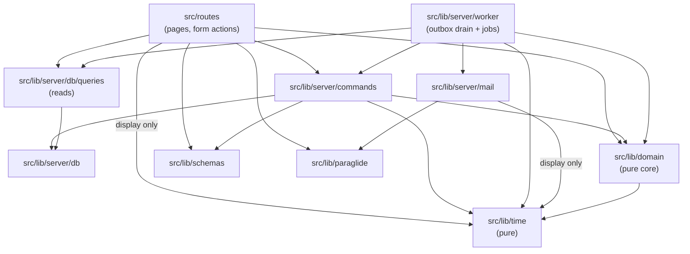
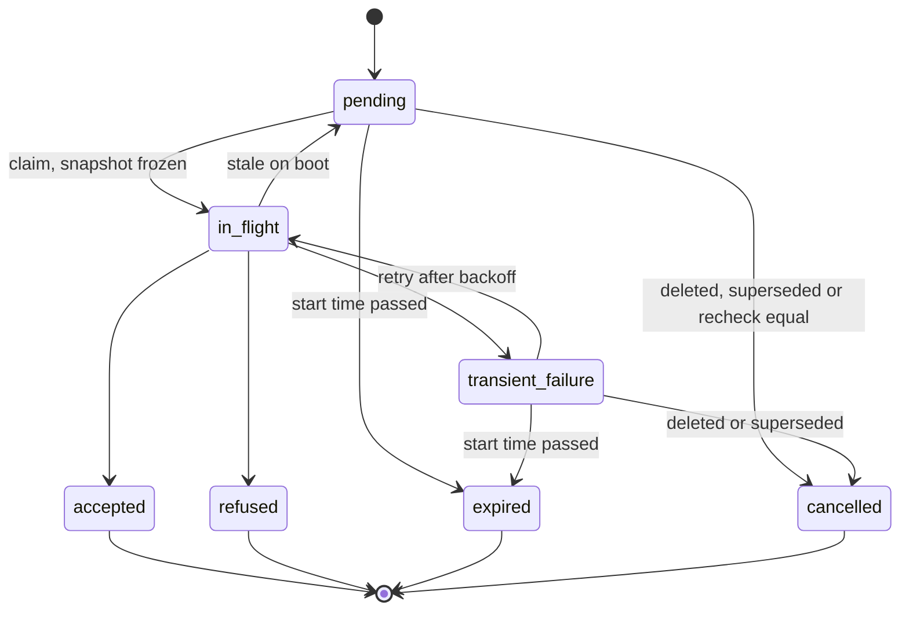
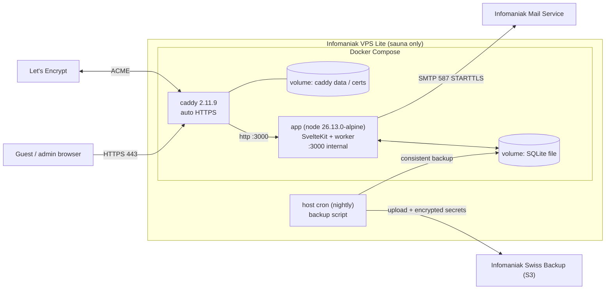
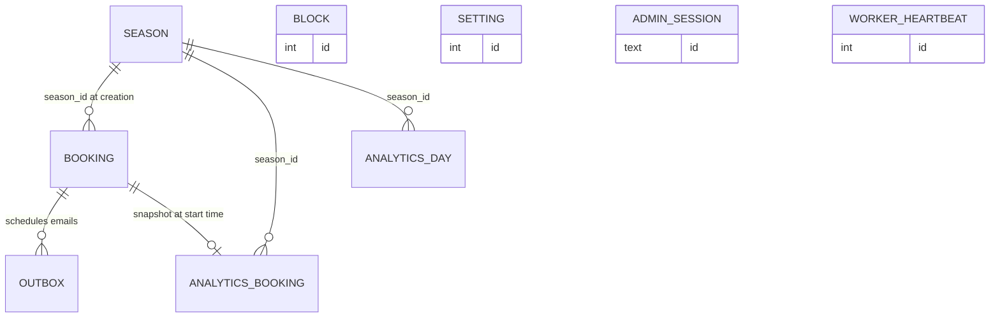

# Architecture Spine — Sauna Luegisee booking calendar

PRD Glossary terms (start time, booking, block, changeover, back to back, heat state, hot, cold start, pre-heat window, arrival time, earliest/latest arrival, notice, last-told notice, heat change, affected booking, settle delay, keybox code, keybox email, 24-hour cutoff, call list, booking horizon, season, operating hours, guest, admin) are used exactly as the PRD defines them, in code identifiers as well as prose.

## Design Paradigm

**Functional core, imperative shell + transactional outbox.** One SvelteKit (adapter-node) process on one VPS, one SQLite file, one in-process worker.

| Layer | Directory | May import |
| --- | --- | --- |
| Pure core | `src/lib/domain` | `src/lib/time` only. No DB, mail, clock, env, I/O |
| Time | `src/lib/time` | Nothing. Pure Europe/Zurich wall-clock logic |
| Shared validation | `src/lib/schemas` | Nothing. Imported by client and server |
| Commands (shell) | `src/lib/server/commands` | domain, time, schemas, db |
| Persistence | `src/lib/server/db` (`db/queries` = reads) | `env.ts` only |
| Worker (shell) | `src/lib/server/worker` | domain, time, commands, `db/queries`, mail |
| Mail | `src/lib/server/mail` | i18n, time (display formatting only), `env.ts`, SMTP transport |
| Routes (shell) | `src/routes` | commands (writes), `db/queries` (reads), domain, time (display formatting only), schemas, i18n |
| i18n | `messages/`, generated `src/lib/paraglide` | Nothing |



## Invariants & Rules

### AD-1 — Pure core owns every rule [ADOPTED]

- **Binds:** FR-1, FR-2, FR-3, FR-4, FR-6, FR-7, FR-12, FR-13, FR-17, FR-18, FR-19, FR-20, FR-21, FR-25, FR-30
- **Prevents:** Heat state, start times, arrival time, notice, affected booking, heat change or its urgency computed differently in a route, a command, the worker or an email.
- **Rule:** `src/lib/domain` exposes pure functions over `(bookings, blocks, settings, outbox rows, now)`: offered start times with durations (all three kinds, clipped to current operating hours, season and horizon), heat state, arrival time, notice (AD-24), affected booking, `noticeEquals`, `classifyHeatChange(lastTold, current) → none | urgent | good_news` (urgent: hot → cold start, later earliest arrival, earlier latest arrival; good_news: cold start → hot), conflicts, keybox phase (AD-6), call-list membership (AD-21), and the out-of-hours/out-of-season flag for existing bookings (derived, never stored; such bookings still count for conflicts and heat state). `now` is always a parameter. The current heat state is never stored for a future booking (stored notices record what was told, AD-7); it is persisted only in the analytics record (AD-12). No other module reimplements any Glossary rule. The layer table is enforced by an ESLint `no-restricted-imports` rule (or equivalent) set up at scaffold, including a ban on `Date.now`, `new Date()` and env access in `src/lib/domain` and `src/lib/time`.

### AD-2 — One command layer for every mutation [ADOPTED]

- **Binds:** FR-5, FR-6, FR-7, FR-14, FR-15, FR-17, FR-18, FR-20, FR-21, FR-28, FR-30, FR-31
- **Prevents:** A route or the worker writing tables directly and skipping recomputation, outbox enqueueing or conflict checks.
- **Rule:** Every write goes through a function in `src/lib/server/commands`: book, delete booking, create block, delete block, change settings (including season rows), change password, mark called, mark reminder done, sign in/out, claim outbox row, record send outcome, record worker heartbeat, snapshot analytics, purge personal data. A command loads state, calls the pure core, writes the change, and enqueues or cancels outbox rows in the same transaction (AD-4). Routes and the worker read through `db/queries` and write only by calling commands; the import-boundary lint (AD-1) allows the db connection and schema to be imported only by `commands` and `db/queries`.

### AD-3 — Exclusive write transactions, in-transaction checks, idempotent submit [ADOPTED]

- **Binds:** FR-5, FR-6, FR-7, FR-17, FR-18, FR-21
- **Prevents:** Two concurrent bookings both succeeding; a block overlapping a booking created a moment earlier; a stale "mark called"; a retried submit reported as a conflict or creating a second booking.
- **Rule:** Each command runs in one `BEGIN IMMEDIATE` SQLite transaction. Checks run inside it against freshly read state: the requested start time and duration are in the core's offered start times (AD-8), block overlap, block inside the changeover between two back-to-back bookings, no block or deletion for time already passed, and displayed notice unchanged for mark called. Of two conflicting requests exactly one succeeds; the other returns a conflict result. Each booking form render carries a random submit token (at least 128 bits) stored on the booking with a unique constraint; a submit whose token already exists returns `{ ok: true }` with the existing booking's public id, never `conflict`. The booking form also posts its displayed notice token; if the notice changed since display, the booking is still made and the confirmation flags the change (EXPERIENCE "Das hat sich gerade geändert").

### AD-4 — Transactional outbox for all guest email [ADOPTED]

- **Binds:** FR-10, FR-11, FR-12, FR-14, FR-16, FR-18, NFR-4, NFR-9
- **Prevents:** Lost emails on crash or downtime; an email sent for a write that rolled back; per-route ad-hoc sending.
- **Rule:** No code sends guest email except the worker. Commands insert outbox rows in the mutation's transaction, of kind `confirmation` (due now), `keybox` (due at the 24-hour cutoff, or now if already past) and `heat_change` (AD-6). Deleting a booking cancels its `pending` and `transient_failure` rows. Rows hold no contact data and no rendered content; each row's lifecycle and send snapshot follow AD-23. Keybox code, changeover, operating hours and season changes enqueue nothing.

### AD-5 — In-process single worker, single instance, heartbeat [ADOPTED]

- **Binds:** FR-11, FR-12, FR-28, FR-30, NFR-4, NFR-9
- **Prevents:** Two SQLite writers; duplicate sends from overlapping ticks or two schedulers; missed sends after downtime; a dead worker going unnoticed.
- **Rule:** A loop started once at server boot (`src/hooks.server.ts` init, guarded by a module-level singleton so dev HMR never starts a second one) ticks about every minute. One tick at a time: the next tick is scheduled only after the current one finishes. A tick drains due outbox rows ordered by due time, then kind (`confirmation`, `keybox`, `heat_change`), then runs the scheduled jobs (AD-12, AD-25), then records a heartbeat through a command. Each tick catches and logs its own errors; the loop never exits. The admin home shows a warning when the last heartbeat is older than 5 minutes. Exactly one app instance ever runs against the database; no horizontal scaling, no separate worker container, no external scheduler endpoint. Every tick is idempotent and catches up on anything due during downtime. SMTP sends happen outside any write transaction (AD-23).

### AD-6 — Heat-change emails: settle, recheck, stop at the keybox phase [ADOPTED]

- **Binds:** FR-11, FR-12, FR-13, FR-14, FR-18, FR-20, FR-21, NFR-4
- **Prevents:** Flapping emails; emails for changes already reverted; a heat-change email contradicting the keybox email; a booking that is on both the email path and the call list, or on neither.
- **Rule:** Every command recomputes the notice of the bookings it can affect: the affected booking for booking or block create/delete; all future non-deleted bookings for a pre-heat window change (the same set the FR-20 preview counts). For each one with a heat change against its last-told notice it upserts exactly one open (`pending` or `transient_failure`) `heat_change` row per booking, due now + settle delay (10 min); an existing open row is reset to `pending` with the new due time (debounce). When claiming, the worker rechecks against the last-told notice: equal → `cancelled`. A booking is in the **keybox phase** once its keybox row is terminal (`accepted`, `refused`, `expired`). Once its keybox row is `in_flight` or terminal, its open `heat_change` rows are cancelled and none are upserted; the keybox snapshot carries the current notice. In the keybox phase, heat changes go to the call list (AD-21), never to email. The keybox email is sent late up to the start time and expires after it.

### AD-7 — Last-told notice ownership [ADOPTED]

- **Binds:** FR-7, FR-10, FR-11, FR-12, FR-13, FR-14, FR-16, FR-21
- **Prevents:** A notice recorded as told when the guest was never told; conflicting writers.
- **Rule:** The booking stores `notice_at_booking` (immutable, shown on the confirmation) and `last_told_notice`, both as AD-24 canonical JSON. The book command sets both to the notice at booking. Afterwards `last_told_notice` is written only by the record-send-outcome command on an accepted `keybox` or `heat_change` row, from that row's send snapshot (never recomputed), and by the mark-called command, from the posted displayed notice token. An accepted `confirmation` leaves it unchanged. A refused, expired or cancelled row never updates it, and an outcome for a deleted booking changes nothing but the row.

### AD-8 — Changeover: current for new bookings, recorded for back to back [ADOPTED]

- **Binds:** FR-2, FR-4, FR-6, FR-20, FR-30
- **Prevents:** A settings change retroactively moving start times, heat states or conflicts of existing bookings; the calendar offering a time the command refuses.
- **Rule:** Each booking stores the changeover in force when it was made, its `created_at` and its `season_id`. A new booking must be at least one current changeover from every existing booking on both sides; offered start times of all kinds (kind 2 = end plus current changeover, kind 3 = ends one current changeover before a booking) and the hot state of a free start time use the current changeover. The calendar and the book command call the same core function, so the calendar never offers a time the command refuses. Existing pairs made under an earlier changeover stay valid and are never rechecked. Two existing bookings are back to back when the gap equals the changeover recorded on the later-made one (by `created_at`, row id breaking ties). The earliest-arrival clamp uses the recorded changeover of the booking ending in the window. Changing the changeover triggers no recomputation, no outbox rows and no emails.

### AD-9 — Time handling [ADOPTED]

- **Binds:** FR-1, FR-4, FR-8, FR-11, FR-20, FR-28, NFR-3, NFR-4
- **Prevents:** DST bugs on 28 March 2027; "same time tomorrow" arithmetic; horizon counted in hours instead of calendar days.
- **Rule:** Instants are persisted and passed as UTC. `src/lib/time` alone converts between instants and Europe/Zurich wall-clock (operating hours, 30-minute grid, calendar days, booking horizon, season bounds, display formatting). The 24-hour cutoff is start instant minus 24 h of real time. Only the shell reads the clock and passes `now` inward. Emails and pages state clock times and dates.

### AD-10 — Admin authentication and sessions [ADOPTED]

- **Binds:** FR-15, FR-20, NFR-7, NFR-8
- **Prevents:** Unrevocable tokens; admin pages reachable without sign-in; an open redirect after sign-in.
- **Rule:** One shared password stored only as an argon2 hash. Sign-in creates a server-side session row in SQLite; the browser holds an opaque random session id in a `Secure`, `HttpOnly`, `SameSite` cookie. Every `/admin` route except `/admin/login` is guarded in `hooks.server.ts`. Changing the password deletes all other sessions. Failed attempts are rate limited per client address (FR-15). The post-sign-in return target is accepted only as a same-origin `/admin` path.

### AD-11 — Cookies and client storage [ADOPTED]

- **Binds:** FR-6, FR-26, NFR-7, NFR-8
- **Prevents:** Non-essential cookies; trackers; third-party requests; guest contact details in URLs, cookies or server-side copies outside a booking.
- **Rule:** Exactly two cookies exist: the language choice and the admin session. `localStorage` holds only the theme choice, applied before first paint by an inline script. `sessionStorage` holds only the guest form details (name, email, mobile), written on input and submit and read by the booking form, so a conflict, a language switch or a second booking does not re-ask; without JavaScript they are re-asked. Guest form details never travel in URLs, cookies or redirects. No third-party scripts, fonts, analytics or pixels, on pages or in emails.

### AD-12 — Analytics records are worker jobs [ADOPTED]

- **Binds:** FR-22, FR-23, FR-24, FR-25, FR-30
- **Prevents:** Analytics drifting when settings change; analytics lost with the purge; hours shifted by UTC grouping; duplicate records after catch-up.
- **Rule:** At each non-deleted booking's start time the worker writes an analytics booking record (unique on booking id): `season_id`, Zurich-local date, start `hhmm`, weekday and ISO week computed by `src/lib/time`, duration, party size, heat state, recorded changeover, and the AD-22 guest key. Once a day has passed, the worker writes an analytics day record (unique on date, with `season_id`) using the settings in force at snapshot time: operating hours, blocks, and free start times of the first or second kind that passed unbooked with their heat state. Accepted limitation: a catch-up after downtime may use settings changed in the meantime. Analytics tables hold no name, email or mobile and are never purged. Bookings deleted before their start time never get an analytics record. Analytics views (FR-22..FR-25) read only analytics tables and group only on the stored local columns.

### AD-13 — Public ids are unguessable [ADOPTED]

- **Binds:** FR-7, FR-10, NFR-7
- **Prevents:** Enumerating bookings or leaking guest data through URLs.
- **Rule:** The confirmation route `/booked/[publicId]` uses a random unguessable id generated at booking, distinct from the row id. No guest data in any http(s) URL or query string served by the app. Row ids appear only in admin routes. Admin-only `mailto:` and `tel:` links may carry guest data.

### AD-14 — One i18n catalog for UI, emails and mailto text [ADOPTED]

- **Binds:** FR-10, FR-11, FR-12, FR-26, FR-27, FR-29, FR-31, NFR-10
- **Prevents:** Emails or prepared texts drifting from UI wording or missing a language; URL shapes changing per locale.
- **Rule:** Paraglide `@inlang/paraglide-js` 2.29.3 (added via `sv add paraglide`), locales `de` (base) and `en`. Locale strategy: cookie, then preferred language, then base locale; no URL prefixes. Every guest-facing string, including email bodies and the FR-31 prepared reply text, is a message in `messages/`. The booking stores the locale active at submit; all emails and the FR-31 prepared text for that booking render in it. Keybox access and return instructions are settings in both languages, not messages.

### AD-15 — Email via Infomaniak SMTP, HTML + text [ADOPTED]

- **Binds:** FR-10, FR-11, FR-12, FR-18, FR-31, NFR-5, NFR-8
- **Prevents:** A second mail provider; HTML-only mails; spam-foldering; guest replies landing in an unread mailbox; dev emailing real guests.
- **Rule:** nodemailer over authenticated SMTP submission to Infomaniak (`mail.infomaniak.com`, port 587, STARTTLS), sender on sauna-luegisee.ch with From name "Sauna Luegisee" and SPF/DKIM/DMARC set on the domain. `Reply-To` of every guest email is the admin contact address setting at send time. Every email has an HTML part and a plain-text part rendered from the send snapshot (AD-23) and the same messages, with `lang` and `Content-Language` matching the booking. "Accepted" means the SMTP server accepted the message. Outside production the transport is a local sink or log, never the real SMTP server.

### AD-16 — Shared validation schemas [ADOPTED]

- **Binds:** FR-5, FR-9, FR-17, FR-20, NFR-2
- **Prevents:** Client and server accepting or normalising different values.
- **Rule:** One schema per form in `src/lib/schemas`, used by the client for inline errors and by the form action before calling the command. Error messages are i18n message keys. The booking schema trims the email and normalises the mobile number to E.164 for storage. The server result is authoritative.

### AD-17 — Deployment on one VPS: Caddy, compose, build on box [ADOPTED]

- **Binds:** NFR-7, NFR-8, NFR-9
- **Prevents:** A build OOM-killing the live app; an exposed app port; manual steps after a reboot; irreproducible builds.
- **Rule:** One Infomaniak VPS Lite for this app only. Docker Compose runs `caddy` (`caddy:2.11.9-alpine`, publishes 80/443, automatic HTTPS for sauna-luegisee.ch, cert data on a persistent volume, access logs disabled) and `app` (multi-stage image on `node:26.13.0-alpine3.24`, `npm ci` from the committed lockfile, non-root, port 3000 on the internal compose network only, SQLite on a named volume, memory-limited). Images are built on the VPS; the host has a 2 GB swapfile. Both services restart automatically after a reboot. The app reads the client address only from Caddy's forwarded header (`ADDRESS_HEADER=x-forwarded-for`, `XFF_DEPTH=1`); the origin is `kit.paths.origin = 'https://sauna-luegisee.ch'` in `svelte.config.js`.

### AD-18 — Backups and secrets leave the box [ADOPTED]

- **Binds:** NFR-6, FR-24, FR-28
- **Prevents:** Losing bookings or the env secrets with the VPS; backups filling the app's disk; a backup blocking app writes.
- **Rule:** The database runs in WAL mode with a busy timeout set at connection. A nightly host cron job takes a consistent online SQLite backup (online backup API or `VACUUM INTO`) and uploads it with `s3cmd` or `rclone` (not the AWS CLI) to the account's Infomaniak Swiss Backup S3 endpoint (Switzerland). Local copies are bounded and treated as transient; the off-box copy is the backup. `GUEST_KEY_SECRET` and the other env secrets are stored in the operators' password manager and as an encrypted copy alongside the Swiss Backup upload. Any feature that changes data growth revisits backup retention. A restore, including the env secrets, is tested before each season opens.

### AD-19 — The pure core is fully unit-tested [ADOPTED]

- **Binds:** FR-1, FR-2, FR-3, FR-4, FR-6, FR-12, FR-13, FR-17, FR-19, FR-21, NFR-3
- **Prevents:** Glossary rules regressing silently.
- **Rule:** Every exported function of `src/lib/domain` and `src/lib/time` has unit tests, including the PRD and UX worked examples (Lena, Jonas, Tom), the 28 March 2027 DST switch, a changeover raised from 15 to 30 minutes next to an existing booking, the collapsed arrival range, `classifyHeatChange` for every direction, and keybox-phase transitions. Tests call the core with an explicit `now`; no DB or mail mocks are needed.

### AD-20 — Deleted bookings are soft-deleted [ADOPTED]

- **Binds:** FR-18, FR-28, FR-30, FR-31
- **Prevents:** Personal data in two places; a deleted booking still counting for conflicts, heat state, call list or analytics.
- **Rule:** Deleting a booking sets `deleted_at`; the row is never removed. Every query and every core input excludes deleted bookings, except the FR-31 reply reminder, which is `deleted_at IS NOT NULL AND reply_done_at IS NULL AND email IS NOT NULL` on the booking itself; only the mark-reminder-done command writes `reply_done_at`. Contact data exists only on `booking`, in nullable columns; the purge (AD-25) sets them to NULL, which also removes any open reminder.

### AD-21 — The call list is derived, never stored [ADOPTED]

- **Binds:** FR-13, FR-14, FR-16, FR-21
- **Prevents:** Stale, duplicate or uncleared call-list entries that disagree with the bookings.
- **Rule:** The call list is computed on each request by the core from non-deleted bookings whose start time has not passed, one entry per booking: (a) in the keybox phase (AD-6) with `classifyHeatChange(lastTold, current)` urgent → call required, good_news → optional; (b) latest `keybox` row or latest urgent `heat_change` row `refused` or `expired`, or a `keybox` row still not `accepted` 15 minutes after its due time (still retried), with `resolved_at` unset → call required, with the reason (a keybox entry shows the keybox code to give). Call required wins when both apply. Mark called (stale-checked by the displayed notice token) writes `last_told_notice` from the displayed notice (AD-7) and sets `resolved_at` on that booking's refused and expired rows, clearing the entry. Other refusals are shown with the booking, derived from its outbox rows; no flag column and no call-list table exist.

### AD-22 — Analytics guest key is a keyed hash [ADOPTED]

- **Binds:** FR-24, FR-28, FR-30
- **Prevents:** Analytics records that can be re-identified from a known email; unique-guest counts breaking across seasons.
- **Rule:** The guest key is HMAC-SHA256 of the trimmed, lowercased email with the secret `GUEST_KEY_SECRET` from env. The secret never changes once set and is kept off-box per AD-18; no plain hash of an email is stored anywhere.

### AD-23 — Outbox row lifecycle and send snapshot

- **Binds:** FR-10, FR-11, FR-12, FR-14, FR-16, FR-18, NFR-4, NFR-9
- **Prevents:** Recording as told what the email did not contain; double sends from overlapping work; rows stuck forever; a send outcome resurrecting a deleted booking.
- **Rule:** Row states follow the diagram below. To send, the worker's claim command, in one transaction, moves a due `pending` or `transient_failure` row to `in_flight` with `claimed_at` and freezes a send snapshot on the row: notice (AD-24), keybox code (keybox rows), language and urgent flag (heat-change rows, from `classifyHeatChange`). The confirmation snapshot carries `notice_at_booking`. The email is rendered only from the snapshot. The record-send-outcome command writes the state and reason, and on `accepted` writes `last_told_notice` per AD-7; the snapshot is the record of the keybox code contained (FR-16). Transient SMTP errors set `transient_failure` with a backoff due time while before the booking's start; a row still unsent at the start time becomes `expired`. On boot, `in_flight` rows older than the in-flight timeout return to `pending` (delivery is at-least-once). Cancellation (booking deleted, heat change superseded or rechecked equal) applies only to `pending` and `transient_failure` rows; an outcome for a deleted booking is recorded and changes nothing else.



### AD-24 — One canonical notice value

- **Binds:** FR-2, FR-3, FR-7, FR-10, FR-11, FR-12, FR-13, FR-16, FR-21
- **Prevents:** Writers and readers of the last-told notice, snapshots and stale-check tokens using different shapes, so comparisons and mark-called checks always or never fail.
- **Rule:** The core defines one Notice value `{ heat: 'hot' | 'cold', earliest: instant | null, latest: instant | null }`. Hot → both null. A collapsed arrival range (earliest later than latest) → `earliest` only, `latest` null. Wherever stored or posted (booking `notice_at_booking` and `last_told_notice`, outbox snapshot, form tokens) it is the core's canonical JSON serialization. Equality (`noticeEquals`) and heat change (`classifyHeatChange`) are core functions; no other code compares notices. "Already past" and "minutes to heat" are derived at render time, never stored.

### AD-25 — Seasons are rows; purge per booking

- **Binds:** FR-1, FR-20, FR-22, FR-23, FR-24, FR-25, FR-28, FR-30
- **Prevents:** Past seasons losing their dates; bookings outside a shortened season escaping the purge or season analytics.
- **Rule:** Seasons live in a `season` table; seasons never overlap; the settings command creates season rows and edits them in place. Each booking stores `season_id` at creation, never changed afterwards. The worker purges each booking (deleted ones included) at max(booking start, its season's current end) + 30 days, setting name, email and mobile to NULL through the purge command. Analytics records carry `season_id` (AD-12).

### AD-26 — Public routes expose only what the guest UI shows

- **Binds:** FR-1, FR-7, FR-10, NFR-7, NFR-8
- **Prevents:** Other guests' contact data or block reasons reaching the browser through serialized `load` or action data.
- **Rule:** Loads and actions under `routes/(guest)` return only a view model: offered start times with durations, heat state and notice, taken intervals as start/end, and season state; the confirmation by unguessable public id returns that booking's date, start time, duration, party size, notice at booking and keybox-email time. Never names, emails or mobile numbers of any booking, and never block reasons. The guest read queries in `db/queries` never select contact columns or block reasons.

## Consistency Conventions

| Concern | Convention |
| --- | --- |
| Naming | Code identifiers use PRD Glossary words in English (`startTime`, `heatState`, `lastToldNotice`, `affectedBooking`, `changeover`). DB tables and columns `snake_case`, singular (`booking`, `block`, `season`, `setting`, `outbox`, `admin_session`, `worker_heartbeat`, `analytics_booking`, `analytics_day`). Files `kebab-case.ts`. Commands are verb-first (`createBooking`, `deleteBlock`, `markCalled`). |
| Ids | Row ids: integer primary keys, admin-only. Public booking id, submit token, session id: random, URL-safe, at least 128 bits. |
| Dates & times | Stored as UTC instants (ISO 8601 text or epoch ms, one form chosen at scaffold, used everywhere including notice JSON). Wall-clock dates in URLs `yyyy-mm-dd`, times `hhmm`, both Europe/Zurich. Durations in whole minutes. |
| Enumerated values | Heat state `hot` · `cold` (cold start). Block reasons `cleaning` · `maintenance` · `private_use`. Locales `de` · `en`; `de` maps to `de-CH` and `en` to `en` for `lang`, `Content-Language` and `Intl`. |
| Outbox | Kinds `confirmation` · `keybox` · `heat_change`. States `pending` · `in_flight` · `accepted` · `refused` · `transient_failure` · `expired` · `cancelled` (AD-23). |
| Command results | A command returns `{ ok: true, ... }` or `{ ok: false, code, ... }`; `code` is a stable string (`conflict`, `stale`, `not_found`, `past`, `invalid`). Commands never throw for expected outcomes. |
| Form action errors | `fail(status, { errors: { field: messageKey }, values })`; `values` echoes input except passwords. A booking conflict or past start (FR-6) returns `fail(409, { code, date })`; the page shows the refreshed day with the message and refills contact details from `sessionStorage` (AD-11). |
| Impact previews | FR-17/18/20 previews call the same pure-core functions as the command; the command recomputes and refuses with `stale` if the outcome changed. |
| Logging | Plain lines to stdout/stderr, collected by Docker. Never log name, email, mobile, keybox code or password. Log each send outcome by outbox row id. Caddy access logs off; login rate-limit entries short-lived. |
| Config | App env read only in `src/lib/server/env.ts`: `DATABASE_PATH`, `SMTP_HOST`, `SMTP_PORT`, `SMTP_USER`, `SMTP_PASS`, `MAIL_FROM`, `GUEST_KEY_SECRET`. adapter-node env set in compose: `ADDRESS_HEADER`, `XFF_DEPTH` (others per adapter-node 6 docs; no `ORIGIN`). Backup script env: Swiss Backup credentials and `SWISS_BACKUP_ENDPOINT`. Business settings (hours, changeover, horizon, pre-heat window, keybox code, instructions, admin contact, password hash) live in the DB, seasons in `season`, edited via FR-20. |
| SvelteKit 3 idioms | Import via `#lib/…` with explicit extensions; `$app/state`, not `$app/stores`; `refreshAll`; hook types from `@sveltejs/kit/hooks`; origin via `kit.paths.origin`. |
| Auth guard | Admin access is checked in `hooks.server.ts`, never only in a page. |

## Stack

| Name | Version |
| --- | --- |
| Node.js | 26 LTS (`node:26.13.0-alpine3.24`) |
| SvelteKit (`@sveltejs/kit`) | 3.1.1 |
| Svelte | 5.57.3 |
| `@sveltejs/adapter-node` | 6.0.1 |
| `@sveltejs/vite-plugin-svelte` | 7.3.1 |
| Vite | 8.3.6 |
| TypeScript | 6.0.3 |
| `svelte-check` | 4.7.8 |
| Vitest | 4.1.12 |
| SQLite (via better-sqlite3) | bundled with better-sqlite3 13.0.3 |
| `better-sqlite3` | 13.0.3 |
| `drizzle-orm` | 0.45.4 |
| `drizzle-kit` | 0.31.11 |
| `nodemailer` | 10.4.0 |
| `@inlang/paraglide-js` | 2.29.3 |
| `argon2` | 0.45.2 |
| Caddy | 2.11.9 (`caddy:2.11.9-alpine`) |
| Docker Compose | 5.7.0 |
| Infomaniak VPS Lite | 1 vCPU, 2 GB RAM, 20 GB disk |
| Infomaniak Mail Service (SMTP 587) | n/a (service) |
| Infomaniak Swiss Backup (S3) | n/a (service) |

## Structural Seed

Deployment (production, single VPS):



Core entities (names and relationships only):



`BLOCK`, `SETTING`, `ADMIN_SESSION` and `WORKER_HEARTBEAT` stand alone; an analytics day copies the blocks and operating hours in force rather than referencing them. The FR-31 reply reminder is state on `BOOKING` (AD-20), not an entity.

Source tree:

```text
src/
  hooks.server.ts          # admin guard, locale, worker start (once)
  lib/
    domain/                # pure core: start times, heat state, notice, heat change, conflicts, keybox phase, call list
    time/                  # pure Europe/Zurich conversions
    schemas/               # shared form schemas
    paraglide/             # generated by Paraglide
    server/
      env.ts               # all app env access
      db/                  # drizzle schema, connection, migrations
        queries/           # read queries (guest queries never select contact data)
      commands/            # every mutation, one transaction each
      worker/              # tick loop, outbox drain, analytics + purge jobs, heartbeat
      mail/                # transport, templates (HTML + text)
  routes/
    (guest)/               # /, /day/[date], /book/[date]/[time], /booked/[publicId], /info, /privacy, /imprint
    admin/                 # login, home (call list, reply reminders, worker warning), day/[date], booking/[id], blocks, settings, analytics
messages/                  # de.json, en.json
docker-compose.yml         # caddy + app
Dockerfile                 # multi-stage, node:26.13.0-alpine3.24
Caddyfile
eslint.config.js           # import-boundary rules (AD-1, AD-2)
scripts/backup.sh          # host cron: SQLite backup + encrypted secrets -> Swiss Backup
```

## Capability → Architecture Map

| Capability / Area | Lives in | Governed by |
| --- | --- | --- |
| Calendar, heat state, arrival time, start times (FR-1..FR-4) | `domain`, `time`, `routes/(guest)` | AD-1, AD-8, AD-9, AD-19, AD-24, AD-26 |
| Booking, no double booking, notice at booking, window, privacy line (FR-5..FR-9) | `routes/(guest)/book`, `commands`, `schemas` | AD-2, AD-3, AD-7, AD-8, AD-11, AD-13, AD-16, AD-26 |
| Guest emails (FR-10..FR-14) | `commands` (enqueue), `worker`, `mail` | AD-4, AD-5, AD-6, AD-7, AD-14, AD-15, AD-23, AD-24 |
| Admin sign-in (FR-15) | `hooks.server.ts`, `commands`, `routes/admin/login` | AD-10, AD-11 |
| Booking list, blocks, deletion, settings (FR-16..FR-20) | `routes/admin`, `commands`, `domain` | AD-2, AD-3, AD-6, AD-8, AD-23, AD-25 |
| Call list, reply reminder (FR-21, FR-31) | `domain` (membership), `commands`, `routes/admin` | AD-1, AD-6, AD-7, AD-14, AD-20, AD-21 |
| Analytics record (FR-30) | `worker` jobs, `commands` | AD-5, AD-12, AD-22, AD-25 |
| Analytics views (FR-22..FR-25) | `routes/admin/analytics` | AD-12 |
| Language (FR-26, FR-27) | Paraglide, `hooks.server.ts`, booking locale | AD-11, AD-14 |
| Retention, privacy statement (FR-28, FR-29) | `worker` jobs, `routes/(guest)/privacy` | AD-18, AD-20, AD-25 |
| Mobile, speed, plain voice (NFR-1, NFR-2, NFR-10) | `routes`, `messages/` | AD-14, DESIGN.md |
| Time (NFR-3) | `time` | AD-9 |
| Email timeliness, deliverability (NFR-4, NFR-5) | `worker`, `mail`, DNS | AD-5, AD-6, AD-15, AD-23 |
| No lost bookings (NFR-6) | host cron, Swiss Backup | AD-18 |
| Admin security, privacy by default (NFR-7, NFR-8) | `hooks.server.ts`, Caddy | AD-10, AD-11, AD-13, AD-17, AD-26 |
| Quiet off-season (NFR-9) | compose restart policy, Caddy, worker catch-up, heartbeat warning | AD-5, AD-17 |

## Deferred

- **CI pipeline** — builds stay on the VPS; revisit (GitHub Actions + registry) only if a build fails on 2 GB + swap.
- **App memory limit value** — pinned in compose at first deploy.
- **Environments** — only production and local dev are implied; whether a staging instance exists is undecided and can wait until after launch.
- **External uptime monitoring and alerting** — after launch; the in-app heartbeat warning (AD-5) and the call list cover the minimum.
- **OS and image updates on an idle box** — patching cadence (unattended upgrades, base-image rebuilds between seasons) decided before the first public deploy.
- **Secrets file mechanism** — `.env` file permissions vs compose secrets on the VPS, settled at first deploy; the off-box copies are fixed by AD-18.
- **Initial admin password bootstrap** — how the first argon2 hash gets into the DB (seed command or first-run env); settled at scaffold.
- **Admin session lifetime** — idle/absolute expiry; owned by the sign-in command.
- **Security headers** — HSTS, `frame-ancestors`, CSP (allowing the inline theme script by hash); set in one place before the first public deploy.
- **Docker log rotation** — stdout logs on a 20 GB disk need a size cap; set in compose at first deploy.
- **Backup retention** — number of local and off-box copies; must be bounded so data purged under FR-28 ages out of backups, and revisited when data growth changes.
- **Migration tooling detail** — drizzle-kit workflow (generate vs push, run at boot vs deploy step).
- **Timezone implementation** — inside `src/lib/time` only: Temporal (enabled by default in Node 26) on the server; browser support or a polyfill checked if client code imports the module.
- **Validation schema library** — chosen at scaffold; AD-16 fixes only that one schema per form is shared.
- **Login rate-limit storage** — in memory (single instance, resets on restart) or SQLite; owned by the sign-in command alone.
- **Retry backoff intervals and in-flight timeout value** — owned by the worker; the states and deadlines are fixed by AD-23.
- **Settings storage shape** — key/value rows or one typed row; owned by `db` and the settings command. Seasons are fixed as rows by AD-25.
- **Paraglide 3 upgrade** — after the first season launches.
- **Email template design** — layout per EXPERIENCE.md email rules; no architectural impact.
- **Analytics views UI (FR-22..FR-25)** — may follow launch; safe because AD-12 records from the first booking.
- **Per-person booking cap, second location** — out of v1; the data model has one wagon and no guest accounts.

### Open questions

- **Domain, sender address and DNS** — sauna-luegisee.ch must be registered, its A record pointed at the VPS, a sender address chosen (PRD OQ1) and SPF/DKIM/DMARC set before the first deploy, not before build.
